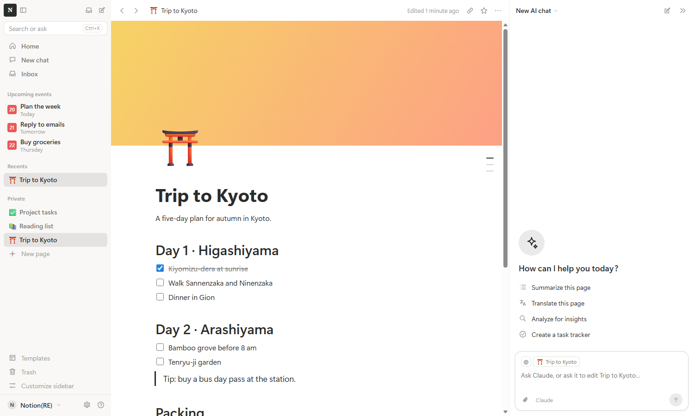
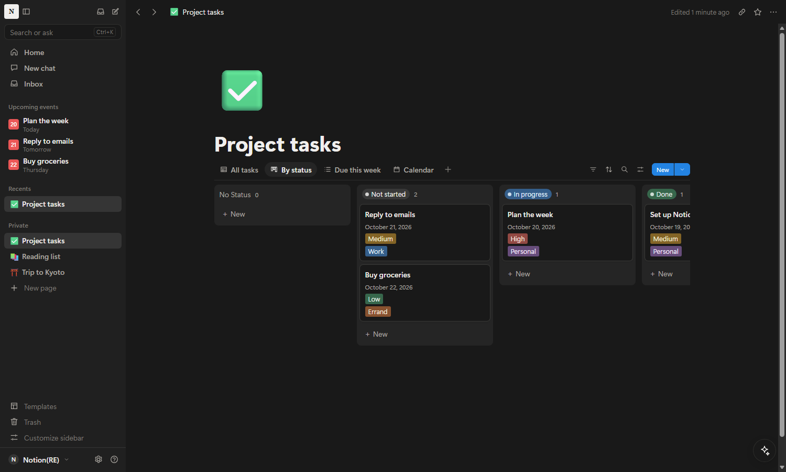
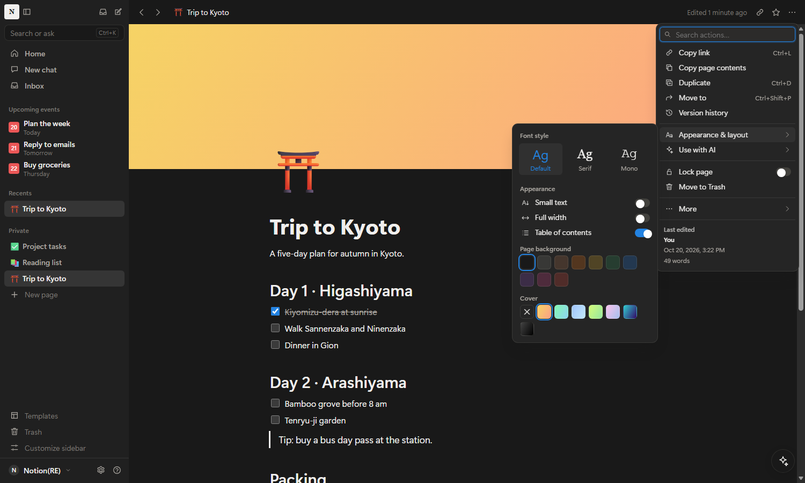

# Notion(RE)

A Notion-style workspace rebuilt from scratch after studying how Notion works, using AI
reverse-engineering tools. Local-first, and the AI runs on **your own** provider instead of a
paid built-in AI service.

> ⚠️ **Showcase only — all rights reserved.** This repository has no open-source license.
> You may view the code, but you may not use, copy, modify or redistribute it.
> Some core modules are intentionally not included, so the project does not build from this repo.



| Databases (board view) | Page menu |
|---|---|
|  |  |

## What it does

- **Block editor**: text, headings, bulleted / numbered lists, to-dos, toggles, quotes,
  callouts, code blocks, dividers, sub-pages
- **Notion-style editing**: `/` command menu, Markdown shortcuts (`#`, `-`, `1.`, `[]`, `>`, `"`,
  ```` ``` ````, `---`), Enter/Backspace splitting & merging, `Tab` / `Shift+Tab` nesting,
  drag-to-reorder, turn-into, duplicate
- **Rich blocks**: images, videos, embeds, bookmarks, simple tables, columns, table of contents,
  toggle headings, page mentions and backlinks, code blocks with syntax colours
- **Pages**: nested page tree in the sidebar, icons, covers, breadcrumbs, search with filters
  (`Ctrl+K`), favorites, page styles (font, full width, background), a floating outline of the
  headings, Notion-style page and block menus with search, links to blocks, find in page,
  Markdown import / export, export of every page as a .zip, backups, undo / redo, page history
  with restore, trash with restore
- **Home, Inbox and Templates**: a start page with recently visited pages, upcoming dates and
  your tasks; reminders on dates and "@Remind me" mentions, with an Inbox and desktop notifications; ready-made templates
  (task tracker, journal, reading list, meeting notes, projects, weekly planner…)
- **Databases**: full-page and inline, with table, board, list, gallery, calendar (month / week)
  and timeline views; filters (including relative dates), sorts, hidden columns, sub-items,
  a calculate row (sum, average, count…), number formats and currencies, a Notion-style date
  picker with ranges and times, row templates, and rows that open in a side peek
- **Bring-your-own AI**: Anthropic (Claude), OpenAI, Google Gemini, or any OpenAI-compatible
  endpoint (OpenRouter, Groq, Ollama…)
  - Press `Space` on an empty line (or `/ai`) to have AI write into the page
  - AI side panel (`Ctrl+J`) to chat about the current page and insert answers
  - Responses stream in live; keys are stored only in the browser
- **Built-in Claude assistant**: the AI panel runs on the owner's own Claude (no API key) and
  works as an agent — it can read, search, create and edit pages and blocks, and its changes
  appear live in the open app. Chats are saved and can be reopened and continued later, and you
  can attach files and screenshots (drag & drop or paste). It can also read files on the computer
  (documents, PDFs, images, Word / PowerPoint / Excel) and bring them into pages — read-only,
  never keys or passwords, and either asking before every file or automatic.
- **Local-first**: the workspace is a file on your own computer, synced live to every open
  tab — no account and no sign-in, no cloud. Your name, photo and email are set by hand in Settings. Falls back to browser storage when run without the local server.
- **Desktop app**: runs in its own window from the Start menu, with a tray icon
- Light & dark mode

## How it was made

See [HOW-IT-WAS-MADE.md](HOW-IT-WAS-MADE.md) — the reverse-engineering process with
[REA](https://github.com/morluto/rea), Claude Code and Claude in Chrome.

## Tech

React 19 · TypeScript · Vite · Zustand · Model Context Protocol (MCP)

---

Not affiliated with, endorsed by, or connected to Notion Labs, Inc. "Notion" is a trademark
of Notion Labs, Inc. No Notion source code is included in this project.

© 2026 loch214. All rights reserved.
